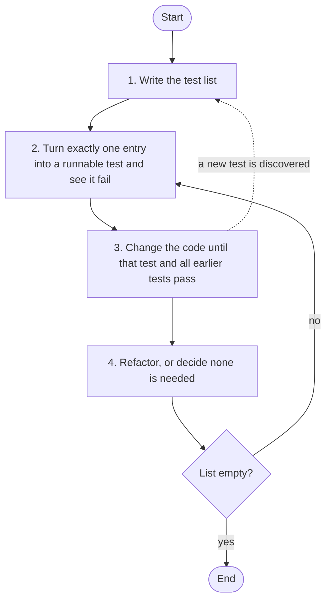

# tdd

Test-driven development, one test at a time. The goal is a new state of the
system where everything that used to work still works, the new behaviour works
as expected, the system is ready for the next change, and you are confident of
all three.

This skill builds on two articles by Kent Beck:
[Canon TDD](https://newsletter.kentbeck.com/p/canon-tdd) and
[Augmented Coding: Beyond the Vibes](https://newsletter.kentbeck.com/p/augmented-coding-beyond-the-vibes).

## The rules a cycle cannot do without

These come first because everything else depends on them.

- **One test at a time.** Write no production code except to make the one test
  in hand pass, and write no second test while one is failing. Mistake: turning
  every test-list entry into a test first and then making them pass one by one.
  Reason: each test is meant to steer the next piece of code; a batch of tests
  steers nothing.
- **See it fail.** A test that has not been seen failing on its assertion, for
  the reason it is about, proves nothing. Reason: a test that cannot fail does
  not test anything.
- **Predict before every run.** Before each compile and test run, write down the
  expected result as one of: compile error (naming what fails to compile), test
  failure (naming the tests and the failure expected), test success. Run and
  compare. A prediction that did not hold, in either direction, means your
  picture of the code is wrong: find out why before changing anything else. Do
  not wave a run through because its result happens to be the one you wanted.
  Reason: the prediction is what turns a run into a check of your understanding.
- **Commit before every run.** Each compile and test run is preceded by a commit
  of the tree exactly as it is about to be built, with the prediction as the
  message. Reason: the commit log becomes the record of every prediction and of
  every test failing before it passed. Details under
  [Commit before every run](#commit-before-every-run).
- **Never weaken a test to get to green.** Do not weaken, skip or delete a test,
  and do not remove an assertion, to make a run pass. If the test itself was
  wrong, correct it and see it fail again. Reason: a test bent to pass no longer
  says what the code must do.

## The cycle

Redrawn from the diagram in Kent Beck's
[Canon TDD](https://newsletter.kentbeck.com/p/canon-tdd).



Mistakes, by the step they belong to:

- 1, the test list: mixing implementation design into the list.
- 2, one test: turning every entry into a test first and then making them pass
  one by one; a test without assertions; expected values copied from what the
  code computed.
- 3, make it pass: mixing refactoring into making the test pass.
- 4, refactor: refactoring further than this piece of work needs; abstracting
  too soon (duplication is a hint, not a command).

## Before the first cycle

Find the project's build and test command once and say which it is. If the
repository has no way to run a test, stop and say so. Do not go on without
tests, and do not invent a test harness unasked. Reason: every step of the cycle
depends on running the tests.

## The test list

- Write it up front, one entry per test, grouped by the unit of work it belongs
  to (a plan step, or the task itself). Keep it in the written plan when one
  drives the work; otherwise keep it in the conversation and show it to the user
  before the first test is written. Reason: the list is the map of the work and
  must outlive any one cycle.
- List every expected variant of the new behaviour, and the ways the change must
  not break existing behaviour. A bug fix has an entry for the test that
  reproduces the bug. Reason: what is not on the list does not get tested.
- An entry says what behaviour is expected, in words a test name could use. It
  holds no implementation design decision. Mistake: mixing implementation design
  into the list. Reason: design is decided while making tests pass, not ahead of
  them.
- Mark an entry `[ ]` while it is to do and `[x]` once its cycle is finished.
- Mark `(may pass)` on a test expected to pass on its first run. It is still
  proven by breaking the production code; see
  [A test that passes on its first run](#a-test-that-passes-on-its-first-run).
- The list may change, and changing it is part of the workflow. Add a test a
  cycle shows to be missing. Strike through a wrong or redundant one with the
  reason; never drop one silently. Reason: the list is a record as well as a
  plan.
- The entries are in a suggested order; you may take them in another. Take the
  simplest failing test first. If a discovered test invalidates work already
  done, decide whether to push on or start over in a different order, and say
  which. Reason: small steps keep each failure easy to read.

## One cycle, for one entry

1. **Write the test, and only that test.** It is a real test with setup, a call
   and assertions. Its name describes the behaviour. It goes through the public
   interface of the code under test, not its internals. Work out expected values
   independently of the code. Mistakes: a test without assertions; expected
   values copied from what the code computed. Reason: a test of internals breaks
   on every refactor, and a value copied from the code checks nothing.
2. **See it fail.** Run the build and all the tests. The kind of failure decides
   what you may write next:
   - something the test uses does not exist: add a declaration or a do-nothing
     body;
   - a call does not fit: fix the signature or add an ignored parameter;
   - an assertion fails: now, and only now, write logic.

   Repeat until the test fails on its assertion, for the reason the test is
   about, with a failure message that says what is wrong. A build error, an
   import error or a run that executed no tests is not that failure. Reason: a
   test that has not been seen failing on its assertion proves nothing.

3. **Make it pass.** Write the least production code that makes this test pass,
   and nothing the test does not ask for. No refactoring here. Mistake: mixing
   refactoring into making the test pass. Reason: code no test asked for is code
   no test checks.
4. **See it pass.** This test passes and every test that passed before still
   passes. Do not weaken, skip or delete the test, and do not remove an
   assertion, to get there. If the test itself was wrong, correct it and go back
   to point 2. Reason: green must mean the behaviour works, not that the test
   gave way.
5. **Refactor, only now that everything passes.** Look at the production and
   test code this cycle touched for duplication, names that do not say what is
   meant, hidden dependencies, a method doing more than one thing, state or side
   effects that are not needed, a responsibility in the wrong place, and
   scaffolding no longer needed. Make the cleanup or conclude none is needed;
   both count, but the look is never skipped. Make one refactoring at a time,
   named by its usual name (extract method, rename, move), and run the tests
   after each one; they give the same results as before it. A refactor adds no
   behaviour and changes no test's meaning. Mistakes: refactoring further than
   this piece of work needs; abstracting too soon (duplication is a hint, not a
   command). Reason: the look is what makes refactoring a decision instead of
   something skipped.
6. **Update the test list.** Mark the entry `[x]`, add missing tests, strike
   wrong ones with the reason. Then take the next entry, until the list is
   empty.

## Structural and behavioural changes stay apart

A structural change rearranges code without changing behaviour: renaming,
extracting, moving. A behavioural change adds or alters what the code does.
Never make the two in the same step. When a behavioural change needs a
structural one first, make the structural one first, as a step of its own, with
the tests run before and after it and giving the same results both times. Reason
(Tidy First): when a step does only one kind of change, an unexpected test
result points straight at its cause.

## A test that passes on its first run

It has not been seen failing, so do point 2 the other way round: break the
production code so the behaviour the test describes is gone, run and see that
test fail for that reason, then undo the break and see it pass again. A test
that stays green while its behaviour is broken is rewritten until it does not.
Commit the break like any other state before its run, and undo it before the
next commit; it never outlives the cycle. This applies whether or not the list
marked the test `(may pass)`; an unmarked one is also a prediction that did not
hold. Such a cycle has nothing to implement and continues at point 5. Reason: a
test only counts once it has been seen to catch the behaviour going missing.

## Deleting an existing test

Delete an existing test only when it asserts behaviour the work removes on
purpose, in the cycle that removes that behaviour, and name it when you report
that cycle. Reason: any other deletion hides a regression.

## Commit before every run

Before each compile and test run, commit the tree exactly as it is about to be
built, on whatever branch is checked out. The message is the prediction, on one
line:

```text
TDD <unit>/<entry, shortened>: <what was just done>; predict <compile error | test failure | test success>: <what should fail, if anything>
```

- Commit even when the tree is red or does not compile. Use `--allow-empty` when
  nothing changed since the last run, so every run has its commit.
- When the previous prediction did not hold, start the next message with
  `missed: <what happened instead>;`.
- Skip no hook.
- These commits are a working log, not deliverables. Nothing during the work
  squashes, reorders or tidies them. Nobody verifies or reviews them one by one:
  not that each compiles, not that each does what its message says. Many are red
  or do not compile on purpose. Do not spend time checking them. Reason: what
  gets verified is the tree at the end of a unit of work, and the commits that
  stay are written at the end; see [Finishing](#finishing).

## Stop and tell the user

Stop and tell the user when any of these shows (Beck's warning signs):

- the work is going in circles, the same change tried again and again;
- code is being written for behaviour nobody asked for, however reasonable a
  next step it seems;
- a test is about to be disabled, deleted or weakened to get to green.

Reason: each of these means the work has left the cycle, and pushing on makes it
worse.

## Finishing

A unit of work is finished when every entry is `[x]` or struck through, the
build succeeds and the whole test suite passes. That tree is what gets verified,
not the working commits that led to it.

When all the work is finished, rewrite the history, with the user, into the
commits a reviewer reads. Each final commit:

- is one logical unit;
- is either structural or behavioural, and says which in its message;
- comes structural before behavioural where both are needed;
- is verified individually: it builds without warnings and the whole test suite
  passes at that commit, and it does what its message says.

The tree after the rewrite is identical to the tree before it. Reason: the final
commits are the ones that stay, so they are the ones held to Beck's commit
discipline.

## When the work is delegated

Whoever implements runs the build and the tests itself inside the cycle. It
reports each cycle briefly, without waiting for an answer: the entry, each run's
prediction and result, what the refactor changed or that nothing needed
changing, and tests to add or strike. Reason: the cycle depends on seeing each
run, and the reports keep the test list current.

## Work outside the cycle

A change with no behaviour to test, such as documentation or removing code a
cycle left unused, is not test-driven. Name it as such and state what proves it
instead, such as the existing tests staying green. It gets an ordinary commit.
Reason: pretending such a change was test-driven would make the log lie.
